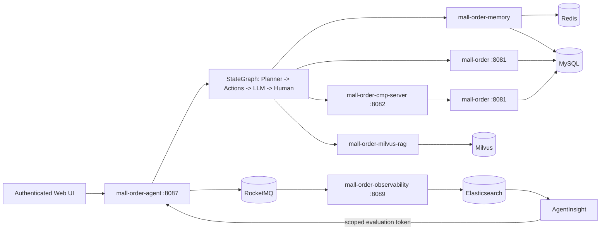

# E-commerce Order Agent Platform

An observable AI Agent for e-commerce order scenarios: uses Spring AI Alibaba StateGraph to orchestrate planning, memory, RAG, order tools, and human confirmation, and asynchronously writes a complete execution trace to Elasticsearch for quality evaluation via AgentInsight.

> Project intent: not a general-purpose chatbot, but an explainable, regression-testable, human-interruptible order agent execution pipeline.

## Project Evolution

This project is a continuous refactor of `EcommSpringBot`, not a new repository created from scratch. The 18 prototype commits are preserved in full in the current Git history; the pre-refactor baseline is tagged `ecommspringbot-v1`. Subsequent commits trace the journey from an experimental mall assistant to a verifiable order agent platform.

| Dimension | EcommSpringBot Prototype | Current Platform |
| --- | --- | --- |
| Module boundaries | Multiple independent experimental modules with duplicate wrappers | Six core modules: Order, MCP, Observability, RAG, Memory, Agent |
| Agent orchestration | Function Calling and early StateGraph experiments | Deterministic Planner, action chain, Graph checkpoint, human interrupt and resume |
| Business security | Mainly validated natural-language order operations | Server-side identity, capability boundaries, order ownership, sensitive-op confirmation, security audit |
| RAG & memory | Independent service prototypes | Combined as Agent dependencies with unified permission scope and Trace contract |
| Quality loop | Primarily interface and log validation | Unit/integration tests, end-to-end smoke, RocketMQ + Elasticsearch Trace, AgentInsight evaluation |
| Delivery | Sub-modules started individually | Root reactor, Docker Compose, unified scripts, and CI |

You can review the evolution rather than just the final code:

```bash
git log --oneline --decorate --graph --all
git diff ecommspringbot-v1..HEAD --stat
```

## Core Capabilities

- **Deterministic planning**: routes questions to order query, RAG Q&A, memory, or sensitive order operations.
- **Human-in-the-Loop**: refund, return, exchange, cancel order, and address change must pause the Graph; execution resumes only after the user confirms.
- **Real business closure**: after-sales operations call the order service via MCP and write to `after_sales_request` — no simulated success text.
- **Deterministic refund eligibility**: the order service produces a four-state verdict based on real-time order, logistics, fulfilment, and product type data; RAG and the LLM can only explain the verdict, never override it.
- **Login and permission workspace**: 8 demo accounts across HR, Engineering, Sales, and Customer roles; identity, knowledge scope, order scope, and tool capabilities are all determined by the login session.
- **Order ownership boundary**: clients cannot supply `actorUserId`; customers can only see their own orders; sales staff can only see assigned customers, with phone and address masked.
- **Hybrid memory**: Redis for short-term session memory, Milvus for long-term semantic memory, MySQL for structured user profile.
- **RAG evidence chain**: 8 built-in demo PDFs with server-side metadata scope filtering, vector retrieval, rerank, and cited-evidence Trace.
- **Async observability**: Traces written via RocketMQ to Elasticsearch; root event, retrieval, LLM, Tool, and human confirmation spans are all trackable.
- **Repeatable verification**: the default `verify` run requires no local ports or external infrastructure; 3 end-to-end smoke scenarios are also available.

## Architecture



## Six Core Modules

| Module | Responsibility | How it runs |
| --- | --- | --- |
| `mall-order` | Order query, ownership check, refund eligibility, cancel order, after-sales ticket persistence | Standalone service, `8081` |
| `mall-order-cmp-server` | Wraps sensitive order operations as MCP Tools | Standalone service, `8082` |
| `mall-order-observability` | Trace publish, consume, ES indexing and query | Standalone service, `8089` |
| `mall-order-milvus-rag` | PDF import, Milvus retrieval, rerank, RAG | Embedded in Agent |
| `mall-order-memory` | Redis short-term memory, Milvus long-term memory, user profile | Embedded in Agent |
| `mall-order-agent` | Planner, StateGraph, LLM, Tools, human confirmation, Web UI | Standalone service, `8087` |

RAG, Memory, and Observability embed into the Agent as libraries; the actual processes you need to start are the Order service, MCP service, Trace consumer service, and Agent — four in total. After building, all four run as executable JARs; Observability also ships a plain JAR for reuse by RAG/Agent.

## Quick Start

### Prerequisites

- JDK 17+
- Docker Desktop / Docker Compose
- A Mistral API key (free tier works)

### 1. Configure environment variables

```bash
cp .env.example .env
```

Fill in `MISTRAL_API_KEY` in `.env`. The local demo default password is `DemoLogin@2026!`; for the admin dashboard, also set `ADMIN_INITIAL_PASSWORD` (at least 12 characters). Service tokens already have loopback-only demo defaults; replace them all for any non-local environment. `.env` is git-ignored.

### 2. Start infrastructure

```bash
docker compose up -d
```

This starts MySQL, Redis, Milvus (with etcd/MinIO), RocketMQ, and Elasticsearch. MySQL automatically creates two schemas and seeds 3 demo orders on first run. Host ports use isolated values (`13306`, `16379`, `29530`, `19876`, `19200`) to avoid conflicts with common local services; container ports remain standard.

### 3. Start the four application processes

| Start order | Application | Default port | Purpose |
| --- | --- | --- | --- |
| 1 | `mall-order` | `8081` | Order query, cancel, and after-sales ticket business API |
| 2 | `mall-order-cmp-server` | `8082` | Exposes order operations as MCP Tools; calls `mall-order` |
| 3 | `mall-order-observability` | `8089` | Consumes Trace events from RocketMQ and writes to Elasticsearch |
| 4 | `mall-order-agent` | `8087` | Web UI and Agent API; orchestrates RAG, Memory, LLM, and order tools |

`mall-order-milvus-rag` and `mall-order-memory` are embedded as dependencies in `mall-order-agent` and do not need to be started separately. In IntelliJ you can run the `All Applications` compound run configuration directly; if Observability is already running you can use `Core Applications` instead. All four sub-configurations activate the `demo` profile.

After startup, open [http://127.0.0.1:8087](http://127.0.0.1:8087).

### 4. Initialise the demo knowledge base

Log in as `admin` and use the admin dashboard to trigger the PDF import, or call the endpoint directly:

```
POST http://127.0.0.1:8087/vector/milvus/documents/import-local
```

This chunks the 8 demo PDFs in `mall-order-milvus-rag/src/main/resources/data`, vectorises them with Mistral embeddings, and writes them to Milvus. Chunks use stable IDs so the import can be run repeatedly without duplication.

## Refund Eligibility Model

`orders.order_status` has five states: `0 Pending Payment`, `1 Paid`, `2 Shipped`, `3 Completed`, `4 Cancelled`. Logistics facts are stored separately in `delivery_status` (`0 Not Shipped`, `1 In Transit`, `2 Delivered`, `3 Rejected`) and `signed_at` to avoid conflating "completed" with the delivery timestamp. Custom and virtual goods use dedicated production and digital-delivery fields. `order_details.product_type` is `0 Standard`, `1 Custom`, `2 Perishable`, `3 Virtual`; refund eligibility is currently assessed per order using a single product type.

`POST /orders/{orderId}/refund-eligibility` returns `ELIGIBLE / INELIGIBLE / NEED_MORE_INFO / MANUAL_REVIEW`, reason codes, missing fields, next action, and rule version. Paid-but-unshipped standard items may apply for a refund immediately without asking about delivery or item condition; no-reason returns for delivered standard items require checking the 7-day window and resalability. After-sales submission re-checks eligibility inside the same transaction and uses an active-ticket business key to make repeated submissions idempotent.

## Login and Demo Accounts

The browser submits only username and password; the business identity comes entirely from the server-side login session. Regular users cannot switch identities or expand their RAG or order scope via request parameters. Five failed logins trigger a 15-minute lockout; sessions idle-expire after 30 minutes and hard-expire after 8 hours; only one active session per account is kept.

| Category | Login / Actor ID | Knowledge scope | Order and tool capabilities |
| --- | --- | --- | --- |
| HR | `hr.linyue` / HR001 | public + hr | Knowledge search only |
| HR | `hr.chenchen` / HR002 | public + hr | Knowledge search only |
| Engineering | `dev.zhouhang` / DEV001 | public + developer | Knowledge search only |
| Engineering | `dev.zhaoning` / DEV002 | public + developer + admin | Technical and Agent ops knowledge |
| Sales | `sales.wanglei` / SALES001 | public + sales | View assigned customer USER1001 orders only; privacy fields masked |
| Sales | `sales.liuting` / SALES002 | public + sales | View assigned customer USER1002 orders only; privacy fields masked |
| Customer | `customer.zhangwei` / USER1001 | public + customer_service | Own two orders, can cancel and raise after-sales with confirmation |
| Customer | `customer.lina` / USER1002 | public + customer_service | Own one completed order, can cancel and raise after-sales with confirmation |

All demo users share the password **`DemoLogin@2026!`**.

Identity catalog, accounts, knowledge scope, capabilities, suggested questions, and sales–customer assignments are initialised by Flyway under the `demo` profile. Dynamic user profiles are still stored in the existing `user_profile` table. The admin can briefly impersonate a business identity in the demo environment after re-entering their password (max 15 minutes); admin commands and sensitive-op confirmations are blocked during impersonation.

### Suggested questions per identity

| Login | Suggested questions |
| --- | --- |
| `hr.linyue` | How is annual leave calculated? · What employee benefits does the company offer? · What are the cross-department collaboration guidelines? |
| `hr.chenchen` | What does a new employee need to prepare for onboarding? · What are the probation period management requirements? · What is the recruitment interview process? |
| `dev.zhouhang` | What standards apply to order API development? · What are the code review requirements? · How should API idempotency be handled? |
| `dev.zhaoning` | How do I troubleshoot Agent service errors? · What should I do if knowledge base import fails? · What should be checked before a service goes live? |
| `sales.wanglei` | What should I watch for when following up on orders? · View orders for my assigned customers · How do I coordinate a customer refund request? |
| `sales.liuting` | How do I follow up on key account orders? · View orders for my assigned customers · What are the boundaries for sales pricing? |
| `customer.zhangwei` | View my orders · Can I get a refund for ORD20260810001? · When will my order be shipped? |
| `customer.lina` | View my orders · Can I still request after-sales for a completed order? · Explain the after-sales processing rules |

### Demo orders

| Order ID | Customer | Item | Amount | Status |
| --- | --- | --- | --- | --- |
| `ORD20260810001` | USER1001 (Zhang Wei) | Demo Phone Pro — 16GB+512GB | ¥5,999 | Paid (not shipped) |
| `ORD20260810002` | USER1001 (Zhang Wei) | Demo Tablet — 256GB | ¥3,299 | Shipped (in transit) |
| `ORD20260810003` | USER1002 (Li Na) | Demo Laptop — 32GB+1TB | ¥8,999 | Completed (delivered) |

### Reset the demo

Demo reset, knowledge base write, account, token, and security audit endpoints are all admin-only and accessible from the admin dashboard.

A reset restores the 3 seed orders to their original state, deletes seed after-sales tickets, and clears the Redis short-term memory, Milvus long-term memory, dynamic user profile, and pending confirmation state for all 8 identities. Personas, knowledge scopes, sales assignments, and the imported knowledge base are not deleted. The internal reset endpoint in `mall-order` exists only under the `demo` profile.

### 5. Run end-to-end smoke scenarios

```bash
./scripts/smoke-test.sh
```

The script validates:

1. `ORDER_QUERY` — query USER1001's order `ORD20260810001`.
2. `RAG_QA` — answer a refund-rules question with a required knowledge base hit.
3. `DANGEROUS_ORDER_OP` — a refund request must pause and wait for confirmation.

To also verify that confirmation actually persists to the database:

```bash
CONFIRM_SENSITIVE=true ./scripts/smoke-test.sh
```

### Stop

```bash
./scripts/stop-apps.sh
docker compose down
```

`docker compose down` without `-v` preserves data volumes for repeated demos.

## Build and Test

```bash
./mvnw verify
./mvnw -pl mall-order-agent -am verify
```

The default test suite uses only unit tests, MockMvc, and mock clients — no MySQL, Redis, Milvus, or external API calls required. Tests named `*LiveIT` / `*IntegrationTest` require a real environment and are excluded from the default Surefire run.

CI is defined in `.github/workflows/ci.yml`; it validates the Compose configuration and runs the full reactor `verify`.

## Trace Contract 1.0

The root Trace uses `agent.ask` or `agent.resume` and retains these stable evaluation fields in `TRACE_END`:

| Field | Meaning |
| --- | --- |
| `traceSchemaVersion` | Contract version, currently `1.0` |
| `agentName` / `agentVersion` | Agent identifier and version |
| `conversationId` | Business conversation ID |
| `queryFingerprint` / `queryLength` | Input identifier without storing the raw text |
| `planStrategy` | Planner's final strategy |
| `grounded` / `interrupted` | Evidence state and human-interrupt state |
| `responseLength` | Output length; output text is not captured |
| `continuedFromTraceId` | Links a `resume` to its original interrupted Trace |

Retrieval spans record `chunkId`, `source`, and `score`; sensitive Tool spans record `operation`, order/user fingerprint, and `executionStatus`. Query text, response text, prompts, order numbers, user IDs, and filter expressions are never stored in the Trace. RocketMQ consumer failures throw exceptions to trigger retry, preventing silent acknowledgement of failed messages.

## Security Scope

- Web layer uses Spring Security, BCrypt-12, Redis server-side sessions, CSRF protection, session-fixation protection, single-session enforcement, and login lockout.
- `actorUserId`, RAG scope, capabilities, and order customer scope all derive from the authenticated principal; cross-user `resume` / `abandon` return 404.
- Order, MCP, and observability endpoints use separate service tokens; health probes remain public; all ports bind to `127.0.0.1` by default.
- AgentInsight uses a dedicated `EVALUATION_ACT_AS` token for `/internal/evaluation/ask`; only the SHA-256 digest is stored, and the token supports revocation.
- Login, account, password, token, impersonation, and denial events are written to a sanitised security audit log retained for 180 days.
- Traces never capture query text, response text, prompts, order numbers, or full user IDs.

Public deployment still requires TLS, a proper secrets manager, an external IdP/MFA, a centralised gateway with rate limiting, and multi-instance checkpoint support. The `local-*-change-me` default tokens are for loopback-only demos only.

## Integration with AgentInsight

The E-commerce Order Agent Platform handles execution; AgentInsight handles observability and evaluation. Once both are connected to the same Elasticsearch `rag-traces` index, AgentInsight can measure quality from `agent.ask / TRACE_END` events and run deterministic regression against Planner, RAG, Tool, and Human spans.

Both sides must be configured with the same `AGENT_EVALUATION_TOKEN`. AgentInsight historic test cases are automatically migrated by V9 to `http://127.0.0.1:8087/internal/evaluation/ask` and do not use web login sessions or client-side identity fields.

Recommended demo sequence:

1. Show how a plain order query bypasses the LLM and goes directly to the deterministic Tool.
2. Show a RAG Q&A with retrieval evidence, rerank scores, and the Trace.
3. Submit a refund request and show the Graph pausing; after confirmation show the MCP call and the MySQL ticket.
4. Open the same `traceId` in AgentInsight and explain how it pinpoints planning, retrieval, or tool issues.

## Known Limitations

- Graph checkpoint and pending-confirmation state are stored in single-process memory; multi-instance and restart recovery are not supported.
- Knowledge base import is an explicit ops step; the same version can be imported idempotently, but changing document content requires a planned old-version cleanup strategy.
- Docker Compose targets local development; it does not include production HA, TLS, backup, or capacity planning.
- End-to-end smoke tests depend on Mistral network availability and API quota; the default unit tests have no such dependency.
